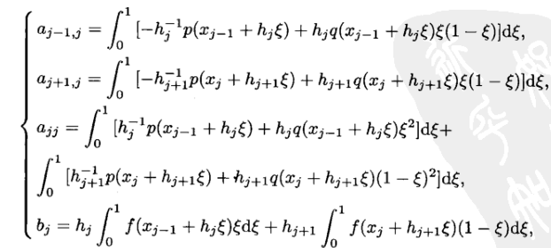
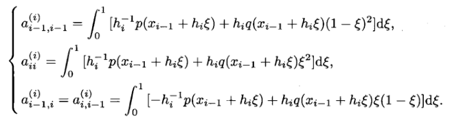
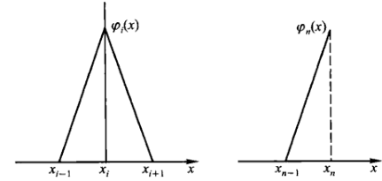
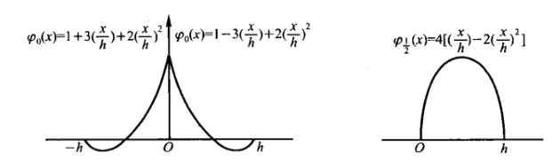
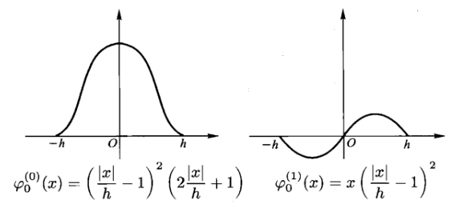

# 两点边值问题的有限元法

- **泛定方程**：$-\dfrac{d}{dx}(p\dfrac{du}{dx}) + qu = f，x\in (a,b)$
- **边值条件**：$u(a) = u'(b) = 0$
- **其它条件**：
  - 设 $I = [a,b]$
  - $p\in C^1(I)，p\geq p_0 \geq 0$
  - $q\in C(I)，q\geq 0$
  - $f\in C(I)$
- **有限元方法**：
  - 有限元方法本质是在Ritz-Galekin方法中，选取分段插值多项式的基函数作为基函数 $\p_i$
  - 因为取的插值点有限，所以基函数数量有限，即试探函数空间是有限维的
  - 此时分段插值多项式的系数（插值点函数值 $u_i$）就是线性组合系数 $c_i$，需要求它们的最优取值

## Ritz有限元法

### 数学推导

- **网格剖分**：取节点 $a = x_0 < ... < x_n = b$，单元为 $I_i = [x_{i-1},x_i]$，步长为 $h_i$
- **试探函数空间**：
  - 设 $H^1_E$ 是满足本质边值条件的索伯列夫空间
  - 取一些至多 $m$ 次的多项式，构成子空间 $U_h$，元素 $u_h$ 称为**试探函数**
- **一次有限元空间（分段线性试探函数空间）**：
  - 设节点上的试探函数值为 $u_0 = 0,u_1,...,u_n$
  - 取分段线性插值公式，构成**单元形状函数** $u_h(x) = \dfrac{x_i-x}{h_i}u_{i-1} + \dfrac{x-x_{i-1}}{h_i} u_i，x\in I_i$
  - 则它们组成的分段线性函数就是试探函数 $u$
  - 由插值知识，这里的试探函数值 $u_i$ 是系数，分式才是基函数
- **有限元方程**：
  - **基函数标准化（0-1化）**：
    - 取仿射变换 $\xi = F_i(x) = \dfrac{x-x_{i-1}}{h}$
      - 将区间 $I_i$ 变为 $[0,1]$，类似凸函数琴生不等式换元，$\xi$ 实际上就是比例系数
    - 设 $\begin{cases} N_0(\xi) = 1-\xi \\ N_1(\xi) = \xi \end{cases}$，则 $u_h(x) = N_0u_{i-1} + N_1u_i，x\in I_i$
    - $N_0$ 是单元左端点处的0-1型基函数，$N_1$ 是单元右端点处的0-1型基函数 
  - **原方程离散化**：
    - 将单元形状函数代入 $J(u) = \dis\frac{1}{2}\int^b_a (pu'^2 + qu^2 - 2fu)dx $，再取仿射变换即可化为 $$ \hspace{-1em}\frac{1}{2}\sum^n_{i=1} \int^1_0 \fkh{ p(x_{i-1} + h_i\xi)\frac{(u_i-u_{i-1})^2}{h_i}}d\xi \\\ \\  + \frac{1}{2}\sum^n_{i=1} h_i \int^1_0 q(x_{i-1} + h_i\xi) (N_0u_{i-1}+N_1u_i)^2 d\xi \\\ \\  - \sum^n_{i=1} h_i \int^1_0 f(x_{i-1} + h_i\xi)(N_0u_{i-1} + N_1u_i)d\xi $$
    - 显然 $u_i$ 可以提取出来，易得驻点方程组是三对角线性方程组，称为**有限元方程** $$ \pfrac{J(u_h)}{u_j} = a_{j-1,j}u_{j-1} + a_{jj}u_j + a_{j+1,j}u_{j+1} - b_j = 0 $$

### 矩阵写法

- **单元刚度矩阵**：$K^{(i)} = \tvec{a^{(i)}_{i-1,i-1} & a^{(i)}_{i-1,i} \\ a^{(i)}_{i,i-1} & a^{(i)}_{ii} }$
  - **系数性**：
    - $J(u_h)$ 的前两项加和的每个单元都是 $u_{i-1},u_i$ 的二次型
    - 设 $\bs u^{(i)} = \tvec{u_{i-1} \\ u_i}$，即前两项单元可写为 $(\bs u^{(i)})^T K^{(i)}\bs u^{(i)}$
- **总刚度矩阵**：$K = \sum\limits^n_{i=1} K^{(i)}$
  - **系数性**：
    - $J(u_h)$ 的前两项是加和，故将上面的单元直接相加即可
    - 设 $\bs u = \tvec{u_1 \\ \vdots \\ u_n}$，即前两项加和可写为 $\cfrac{1}{2}\bs u^T K\bs u$
  - **三对角性**：$a_{ij} = \begin{cases} a^{(i)}_{i,j-1} & j = i-1（左下侧） \\ a^{(i)}_{ii} + a^{(i+1)}_{ii} & j=i \\ a^{(i+1)}_{i,i+1} & j = i+1（右上侧） \\ 0 & |j-i|\geq 2 \end{cases}$
- **右端向量**：$\bs b = \tvec{b_1 \\ \vdots \\ b_n}$，其中 $b_1 = f^{(1)}_1 + f^{(2)}_1，b_2 = f^{(2)}_2 + f^{(2)}_3，... ，b_n = f^{(n)}_n$
  - **系数性**：
    - 比较易得 $J(u_h)$ 的第三项可写为 $\sum\limits^n_{i=1} (\bs u^{(i)})^T\bs f^{(i)}$
    - 写成向量形式就是 $\bs u^T\bs b$
- **有限元方程（矩阵写法）**：
  - 上面分别给出了 $J(u_h)$ 三个项的向量写法，综合即得 $J(u_h) = \dfrac{1}{2}\bs u^T K \bs u  - \bs u^T\bs b$
  - 由最小势能原理即得有限元方程为 $K\bs u = \bs b$

### 非齐次边值条件情况

- **左边值（第一边值）非齐次**：$u(a) = \a$
  - 增加 $I_1 = [x_0,x_1]$ 对应的单元刚度矩阵 $K^{(0)}$
- **右边值（第二边值）非齐次**：$u'(b) = \b$
  - 能量泛函改为 $J(u) = \dis\frac{1}{2}\int^b_a [pu'^2 + qu^2 - 2fu]dx - \b p(b)u_n$
  - 总刚度矩阵不变，第 $n$ 个方程的右端累加 $\b p(b)$
- **右边值（第三边值）非齐次**：$u'(b) + \a u(b) = \b$

## Galekin有限元法

- 两个方法只在最后的内积方程离散化步骤上不同
- **网格剖分**：同上
- **试探函数空间**：同上
- **构造基函数**：$$\p_i(x) = \begin{cases} \dfrac{x-x_{i-1}}{h_i} & x_{i-1} \leq x \leq x_i \\ 1-\dfrac{x-x_i}{h_{i+1}} & x_{i} \leq x \leq x_{i+1} \\ 0 & 其它 \end{cases}$$
 

- **有限元方程**：
  - **基函数标准化**：取仿射变换，则基函数变为 $$ \p_i(x) = \begin{cases} N_1(\xi) = \xi & x_{i-1} \leq x \leq x_i \\ N_0(\xi) = 1-\xi & x_{i} \leq x \leq x_{i+1} \\ 0 & 其它 \end{cases} $$
  - **原方程离散化**：
    - 已知边值问题对应的双线性形式为 $a(u,v) = \dis\int^b_a [pu'v' + quv]dx$
    - 已知Galekin方程为 $\dis\sum^n_{i=1} a(\p_i,\p_j)u_i = \int^b_a f\p_j dx，j=1,...,n$
    - 易得 $|j-i|\geq 2$ 时 $\p_i\p_j = 0$，故方程左端的系数矩阵是三对角矩阵
    - 代入后换元得 $$ a(\p_{j-1},\p_j) = \int^1_0 \ffkh{-\frac{p(x_{j-1} + h_j\xi)}{h_j} + h_j\xi(1-\xi)q(x_{j-1} + h_j\xi) } d\xi $$
    - 代入后换元得（此时满足 $|j-i|<2$ 的有两段，所以有两个积分） $$ a(\p_j,\p_j) =  \int^{x_j}_{x_{j-1}}[p\p_j'^2 + q\p_j^2]dx  + \int^{x_{j+1}}_{x_j} [p\p_j'^2 + q\p_j^2]dx \\\ \\ = \int^1_0 \ffkh{\frac{p(x_{j-1} + h_j\xi)}{h_j} + h_j\xi^2 q(x_{j-1} + h_j\xi) } d\xi  \\\ \\ + \int^1_0 \ffkh{\frac{p(x_j + h_{j+1}\xi)}{h_{j+1}} + h_{j+1}(1-\xi)^2q(x_j + h_{j+1}\xi) } d\xi  $$
    - 代入后换元得 $$ a(\p_{j+1},\p_j) = \int^1_0 \ffkh{-\frac{p(x_j + h_{j+1}\xi)}{h_{j+1}} + h_{j+1}\xi(1-\xi)q(x_j + h_{j+1}\xi) } d\xi $$
    - 代入后换元得 $$ (f,\p_j) = h_j\int^1_0  f(x_{j-1}+h_j\xi)\xi d\xi + h_{j+1} \int^1_0 f(x_j + h_{j+1}\xi)(1-\xi)  d\xi $$
    - 比较即得Galekin方程的系数矩阵就是总刚度矩阵

### 非齐次边值条件情况

- **左边值（第一边值）非齐次**：$u(a) = \a$
  - 增加基函数 $\p_0(x) = \begin{cases} 1-\dfrac{x-x_0}{h_1} & x_0\leq x\leq x_1 \\ 0 & 其它 \end{cases}$
  - 线性分解式变为 $u_h = \a \p_0(x) + \sum\limits^n_{i=1} u_i\p_i(x)$，未知数数量（自由度）不变
  - 有限元方程变为 $\sum\limits^n_{i=1} a(\p_i,\p_j)u_i = (f,\p_j) - \a a(\p_0,\p_j)$
    - 只改变了第一个方程的右端
- **右边值（第二边值）非齐次**：$u'(b) = \b$
  - 基函数不变，线性分解式不变
  - 有限元方程变为 $\sum\limits^n_{i=1} a(\p_i,\p_j)u_i = (f,\p_j) + p(b)\b\p_j(b)$
    - 只改变了第 $n$ 个方程的右端

## 收敛性和误差估计

## 高次有限元方法（$n$ 次分段多项式）

- 提高精度的方法本质是增加 $U_h$ 的维数
  - 剖分加细
  - 增加插值多项式次数
    - Lagrange型（单元内部添加新插值点）
    - Hermite型（单元端点添加导数插值）

### 二次元

- 基函数是二次插值多项式，每个单元需要三个节点值
- 我们取Lagrange型构造，即考虑单元区间的端点和中点
  
  - 已知基函数只取决于节点和节点值，而这里节点和节点值都轴对称，故基函数 $N_0$ 和 $N_1$ 的图像轴对称，即我们只需求 $N_0$ 即可
- **网格剖分**：同上
- **构造端点基函数**：选取在单元节点连续处的二次多项式
  - **插值条件**：$N_0(0) = 1，N_0(\dfrac{1}{2}) = N_0(1) = 0$
    - 0-1型基函数，即Kronecker函数
  - **仿射形式**：求解易得 $N_0(\xi) = (2\xi-1)(\xi-1)$
  - **端点基函数**：代入仿射逆变换即得 $$ \p_i(x) = \begin{cases} \dkh{2\dfrac{|x-x_i|}{h_i}-1} \dkh{\dfrac{|x-x_i|}{h_i}-1} & x_{i-1} \leq x\leq x_i \\\\ \dkh{2\dfrac{|x-x_i|}{h_{i+1}}-1} \dkh{\dfrac{|x-x_i|}{h_{i+1}}-1} & x_i \leq x\leq x_{i+1} \\\\ 0 & 其它 \end{cases} $$
- **构造中点基函数**：
  - **插值条件**：$N_{\frac{1}{2}}(0) = N_{\frac{1}{2}}(0) = 0，N_{\frac{1}{2}}(\frac{1}{2}) = 1$
  - **仿射形式**：求解易得 $N_{\frac{1}{2}}(\xi) = 4\xi(1-\xi)$
  - **中点基函数**：代入仿射逆变换即得 $$ \p_i(x) = \begin{cases} 4\dfrac{x-x_i}{h_{i+1}} \dkh{1-\dfrac{x-x_i}{h_{i+1}}} & x_i \leq x\leq x_{i+1} \\\\ 0 & 其它 \end{cases} $$
- **线性分解式**：$u_h = \sum\limits_{i} \ffkh{ u_i\p_i(x) + u_{i+\frac{1}{2}}\p_{i+\frac{1}{2}}(x) }$
  - 易得 $u_h\in C^1(I)$，即 $U_h\subset H^1(I)$

### 三次元

- 基函数是三次插值多项式，需要四个节点值
- 我们取Hermite型构造，即考虑单元区间端点的零阶导和一阶导
  
  - 通过比较节点、节点值、节点导数值，易得两个零阶导基函数轴对称，两个一阶导基函数中心对称
- **网格剖分**：同上
- **构造零阶导基函数**：
  - **插值条件**：$N_0(0) = 1，N_0'(0) = N_0(1) = N_0'(1) = 0$
  - **仿射形式**：求解易得 $N_0(\xi) = (1-\xi)^2(2\xi + 1)$
  - **零阶导基函数**：代入仿射逆变换即得 $$ \p_i^{(0)}(x) = \begin{cases} \dkh{1-\dfrac{|x-x_i|}{h_i}}^2 \dkh{2\dfrac{|x-x_i|}{h_i}+1} & x_{i-1} \leq x\leq x_i \\\\ \dkh{1-\dfrac{|x-x_i|}{h_{i+1}}}^2 \dkh{2\dfrac{|x-x_i|}{h_{i+1}}+1} & x_i \leq x\leq x_{i+1} \\\\ 0 & 其它 \end{cases} $$
- **构造一阶导基函数**：
  - **插值条件**：$N_1(0) = 0，\dfrac{dN_1(\xi)}{dx}\Big|_{\xi=0} = 1， N_1(1) = N_1'(1) = 0$
  - **仿射形式**：求解易得 $N_0(\xi) = c\xi(1-\xi)^2$，其中 $c = \begin{cases} -h_i & x_{i-1} \leq x \leq x_i \\ h_{i+1} & x_i\leq x\leq x_{i+1} \end{cases}$
  - **零阶导基函数**：代入仿射逆变换即得 $$ \p_i^{(1)}(x) = \begin{cases} (x-x_i) \dkh{\dfrac{|x-x_i|}{h_i}-1}^2 & x_{i-1} \leq x\leq x_i \\\\ (x-x_i) \dkh{\dfrac{|x-x_i|}{h_{i+1}}-1}^2 & x_i \leq x\leq x_{i+1} \\\\ 0 & 其它 \end{cases} $$
- **线性分解式**：$u_h = \sum\limits_{i} \ffkh{ u_i\p_i^{(0)}(x) + u_i'\p_i^{(1)}(x) }$
  - 易得 $u_h\in C^2(I)$，即 $U_h\subset H^2(I)$