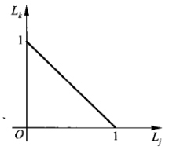
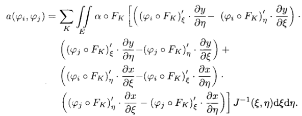

# 椭圆边值问题的有限元法

- **广义坐标**：有限元方法中，将节点处的试探函数值 $u_j$（有限元方程的未知数，线性组合的系数）称为广义坐标

## 矩形元剖分法

- **矩形剖分**：取边和坐标轴平行的有限个相邻矩形
- **仿射变换**：
  - 设矩形 $R_{ij} = [x_i,x_j+\D x;\pad y_j,y_j + \D y]$
  - 取仿射变换 $\begin{cases} \xi = \dfrac{x-x_i}{\D x} \\\\ \eta = \dfrac{y-y_j}{\D y} \end{cases}$，则变为标准正方形 $I\times I = [0,1]^2$

### Lagrange型公式

#### 一次

- **乘积型二元插值公式**：
  - 取一维线性插值基函数 $N_0 = 1-\xi，N_1 = \xi$，则下面就是二维矩形的插值公式 $$P_{11}(\xi,\eta) = N_0(\xi)N_0(\eta)u_{00} + N_0(\xi)N_1(\eta)u_{01} \\\ \\ + N_1(\xi)N_0(\eta)u_{10} + N_1(\xi)N_1(\eta)u_{11} $$
- **乘积插值定理**：乘积型区域的插值公式都可类似写为上面形式
- **试探函数**：取仿射逆变换后，将各个单元拼凑成整体函数
  - 实际计算时一般不用取仿射逆变换，这样计算更方便
  - **连续性**
    - **证明**：
      - 由于线性函数连续，故只需证明公共边处连续
      - 易得 $u$ 在公共边上是单变量线性函数，且在两端取相同值，即相邻单元的边值相同，故连续
- **基函数**：
  - 显然四个基函数就是 $N_i(\xi)N_j(\eta)$
  - 仿射逆变换得 $\p_{ij}(x,y) = \begin{cases} \dkh{1-\dfrac{|x-x_i|}{\D x}}\dkh{1-\dfrac{|y-y_j|}{\D y}} & (x,y)\in R_{ij} \\ 0 & 其它 \end{cases}$

#### 二次

- **乘积型二元插值公式**：
  - 取一维二次插值基函数 $\begin{cases} N_0 = (2\xi -1)(\xi-1) \\ N_{\frac{1}{2}}(\xi) = 4\xi(1-\xi) \\ N_1(\xi) = \xi(2\xi - 1) \end{cases}$
  - 则二维矩形的插值公式 $P_{22}(\xi,\eta) = \sum\limits^2_{i,j=0} N_{\frac{i}{2}}(\xi) N_{\frac{j}{2}}(\eta) u_{\frac{i}{2}\frac{j}{2}}$

#### 三次

- **乘积型二元插值公式**：
  - 取一维二次插值基函数 $\begin{cases} N_0 = \\ N_{\frac{1}{3}}(\xi) =  \\ N_{\frac{2}{3}}(\xi) =  \\ N_1(\xi) = \end{cases}$
  - 则二维矩形的插值公式 $P_{33}(\xi,\eta) = \sum\limits^3_{i,j=0} N_{\frac{i}{3}}(\xi) N_{\frac{j}{3}}(\eta) u_{\frac{i}{2}\frac{j}{2}}$

### Hermite型公式

- **Adini元**：广义坐标只有 $u,u_x,u_y$，不含混合偏导数
  - **非协调性**：法向导数不连续
  - 由于二元三次多项式最多只有 $10$ 个广义坐标，而矩形四个顶点处的广义坐标一共有 $12$ 个，故只能添加两项 $\a x^3y$ 和 $\b xy^3$
- **BFS元**：广义坐标含有 $u,u_x,u_y,u_{xy}$
  - **协调性**：法向导数连续

#### Adini元

- **插值基函数**：设某点处的插值基函数为 $N^i(\xi,\eta)$
  - **插值条件**：
    - $N^{(0)}$ 仅在 $(0,0)$ 处函数值为 $1$，其余函数值和导数值均为 $0$
    - $N^{(1)}$ 仅在 $(0,0)$ 处对 $\xi$ 偏导数值为 $1$，其余函数值和导数值均为 $0$
    - $N^{(2)}$ 仅在 $(0,0)$ 处对 $\eta$ 偏导数值为 $1$，其余函数值和导数值均为 $0$
  - **待定系数法求插值基函数**：
    - 已知插值多项式为 $N^i = P_3 + \a \xi^3\eta + \b \xi\eta^3$
    - 分别代入插值条件即可
- **有限元基函数**：关于 $(x_i,y_j)$ 的基函数为 $$ \p^{(0)}_{ij} = \begin{cases} N^{(0)} & (x,y)\in R_{ij} \\ 0 & 其它 \end{cases} $$ $$ \p^{(1)}_{ij} = \begin{cases} N^{(1)} & (x,y)\in R_{ij} \\ 0 & 其它 \end{cases} $$ $$ \p^{(2)}_{ij} = \begin{cases} N^{(2)} & (x,y)\in R_{ij} \\ 0 & 其它 \end{cases} $$
- **线性分解公式**：$$u(x,y) = \sum_{i,j} \ffkh{u_{ij}\p_{ij}^{(0)} +  (u_x)_{ij}\p^{(1)}_{ij} + (u_y)_{ij}\p^{(2)}_{ij}} $$
  - **连续性**
  - **分段可微性**

## 三角形元剖分法

- **三角剖分**：设 $G$ 是多边形，将其分割为有限三角形网
  - **单元**：三角形
  - **节点**：三角形的节点
  - **相邻节点**：同一单元的顶点
  - **相邻单元**：存在公共边的单元
- **三角面积坐标**：
  - 设 $\D(i,j,k)$ 是以 $i,j,k$ 为顶点的三角形单元，面积为 $S$
  - 在单元上任取一点 $P$，将单元剖分成三个小三角形，面积设为 $S_i,S_j,S_k$
  - 设 $L_i = \cfrac{S_i}{S}，L_j = \cfrac{S_j}{S}，L_k = \cfrac{S_k}{S}$，则 $P$ 的坐标可写为 $(L_i,L_j,L_k)$
  - 三个顶点的坐标为 $i = (1,0,0)，...$
- **面积坐标转换公式**：
  - 设 $P$ 的直角坐标为 $(x,y)$，三个顶点的直角坐标为 $(x_i,y_i),...$
  - 则 $$ L_i = \cfrac{\vvec{1 & x & y \\ 1 & x_j & y_j \\ 1 & x_k & y_k}}{\vvec{1 & x_i & y_i \\ 1 & x_j & y_j \\ 1 & x_k & y_k}} ， L_j = \cfrac{\vvec{1 & x_i & y_i \\ 1 & x & y \\ 1 & x_k & y_k}}{\vvec{1 & x_i & y_i \\ 1 & x_j & y_j \\ 1 & x_k & y_k}} ， L_k = \cfrac{\vvec{1 & x_i & y_i \\ 1 & x_j & y_j \\ 1 & x & y}}{\vvec{1 & x_i & y_i \\ 1 & x_j & y_j \\ 1 & x_k & y_k}}$$
- **仿射变换**：
  - 已知 $$ \begin{cases} x = x_iL_i + x_jL_j + x_kL_k \\ y = y_iL_i + y_jL_j + y_kL_k  \end{cases}$$
  - 再由 $L_i = 1 - L_j - L_k$，代入上式即得 $L_jL_k$ 平面 $\to xy$ 平面的逆仿射变换
  - 取逆即得仿射变换，三角单元变为直角坐标单纯形
  

### Lagrange型公式

- 

### Hermite型公式

## 有限元方法

- **泛定方程**：$-\nabla\ddkh{a(x,y)\nabla u(x,y)} = f(x,y)，(x,y)\in G$
- **第一边值条件**：$u|_\G = 0$
- **双线性型**：$a(u,v) = \dis\iint_G a(x,y)\ffkh{u_xv_x + u_yv_y}dxdy$
  - **标准化**：
    - 设 $K$ 是网格剖分单元，逆仿射变换为 $F_K:(\xi,\eta)\to (x,y)$
    - 再由仿射变换的定义易得 $\dpfrac{\xi}{x} = \cfrac{\pfrac{y}{\eta}}{J_F}，...$
      - 即二维形式的反函数导数公式
    - 最后由重积分变量代换公式 + 线性分解公式即得标准化
    
- **有限元求解**：
  - 常系数方程在均匀网格下得到的有限元方程中，广义坐标可直接提取出积分，从而化为线性方程组
  - 但变系数方程、非均匀网格等情况时，最好使用数值积分公式

### 处理边值条件

- 