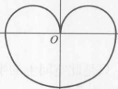

# 拓扑向量空间

- **背景**：
  - 为了研究对偶空间上的收敛性和连续性，需要引入弱收敛和弱拓扑的概念
  - 但弱拓扑不是度量拓扑，也就是说需要研究一类"具有线性的不可度量化拓扑空间"，即拓扑向量空间
- **符号约定**：
  - 集合减法表示全体元素相减后形成的新集合
    - $A-B = \hkh{a-b\mid a\in A,b\in B}$
  - 数域 $\K = \R$ 或 $\C$
  -  $\mc N(x)$ 表示邻域系（$x$ 的全部邻域）
  -  $\mc B(x)$ 表示邻域基（可以任意小的一列邻域）

## 基本概念

- **向量拓扑**：
  - 向量空间上的拓扑，满足以下性质
    - 单点集是闭集（T1公理）
    - 线性运算是连续映射（代数结构和拓扑结构相容）
- **拓扑向量空间**：具有向量拓扑的向量空间
  - **实例**：
    - 赋范线性空间是拓扑向量空间
    - $L^p$ 在 $p\in (0,1)$ 时是拓扑向量空间，但不是赋范线性空间
  - **反例**：
    - 非线性曲面是度量空间，但不是拓扑向量空间
    - 离散拓扑的 $\R$ 不是拓扑向量空间
      - 因为 $\{0\}$ 不是吸收集
- **T2性**：拓扑向量空间是T2空间
  - **证明**：
    - 任取不同点 $x,y$，此时 $x-y\neq 0$
    - 再由T1公理得 $\{0\}$ 是闭集，故补集是开集，从而存在开邻域 $U(0)$ 使得 $x-y\notin U$
    - 再由线性运算连续性（保邻域性），存在开邻域 $V(0)$ 使得 $V-V\subset U$
      - 故 $x-y\notin V-V$，从而 $(x+V)\cap (y+V) = \varnothing$

### 平移不变性

- **平移不变度量**：若任意两点平移后距离不变，则称度量满足平移不变性
  - **实例**：范数是平移不变度量
  - **反例**：$d(x,y) = |x^3-y^3|$ 不是平移不变度量
- **平移不变拓扑**：若 $U$ 是开集 $\LR\forall x\in X$ 都有 $x+U$ 是开集，则称拓扑满足平移不变性
  - 拓扑性质可以从局部推广到整体，故只需讨论原点附近的邻域即可
  - **实例**：
    - 向量拓扑是平移不变拓扑
      - 平移不变性可由线性运算连续性推出
    - 平移不变度量诱导的拓扑是平移不变拓扑

### 线性同胚

- **线性同胚**：若拓扑向量空间上的线性映射是同胚，则称为线性同胚
  - 线性同胚 = 同构 + 同胚，它是拓扑向量空间的等价
- **伸缩平移算子**：
  - 设 $X$ 是拓扑向量空间，$a\in X，\l\in \K$ 非零
  - 则 $\tau_{a,\l}:X\to X，x\mapsto \l x + a$ 称为伸缩平移算子
- **线性同胚性**：伸缩平移算子是线性自同胚
  - **证明**：显然

### 习题

- **不相交平移定理**：
  - 设 $X$ 是拓扑向量空间，$K$ 是紧集，$F$ 是闭集
  - 若 $K$ 和 $F$ 不相交，则存在邻域 $V(0)$ 使得 $K+V$ 和 $F+V$ 不相交
  - 本质是实变函数的：不相交紧集和闭集存在正距离
  - **证明**：
- **正则性**：拓扑向量空间是T3空间
  - **证明**：由不相交平移定理易得
- **运算法则**：
  - **并集分配律**：$A+(B\cup C) = (A+B)\cup (A+C)$
    - **证明**：取样法即可
  - **交集无分配律**：$A+(B\cap C) \subset (A+B)\cap (A+C)$
    - 反向包含关系不成立
    - **证明**：取样法即可
  - **并集展开式**：$(A\cup B) + (C\cup D) = (A+C)\cup (A+D)\cup (B+C)\cup (B+D)$
    - **证明**：取样法即可
  - **交集无展开式**

## 凸性

- **平衡集**：
  - 设 $X$ 是向量空间，$A$ 是子集
  - 若 $\forall |\l| \leq 1，x\in A$ 都有 $\l x\in A$，则称 $A$ 是平衡集
    - 等价于 $\forall |\a| \leq |\b|$ 都有 $\a A \subset \b A$
    - 围绕原点收缩时，集合形状不变
  - **中心对称性**：
    - **证明**：取 $\l = -1$ 即可
  - **实例**：
    - 以原点为心的多面体
    - 过原点的线性子空间
  - **反例**：
    - 包围原点的半圆盘
    - 两个不相交圆盘，彼此中心对称，但不包含原点
    - 两个不相交圆盘，彼此中心对称，用细条过原点连接起来，则它连通、中心对称、包含原点、无洞，但不是平衡集
  - **传递性**：
    - **闭包传递性**：
      - **证明**：
        - 设 $|\l| \leq 1$，$\Psi(x) = \l x$
        - 由平衡性得 $\Psi(A) \subset A$
        - 再由连续映射的保闭包性即得 $\Psi(\ol A)\subset \ol A$，从而闭包也是平衡的
    - **内部传递性**：若 $A$ 以 $0$ 为内点，则 $\oo A$ 也是平衡集
      - **证明**：
        - 设 $|\l| \leq 1$，由平衡性即得 $\l \oo A\subset \l A \subset A$
          - 若 $\l \neq 0$，由同胚性得 $\l\oo A$ 也是开集，故 $\l\oo A \subset \oo A$
          - 若 $\l = 0$，则由中心对称性得 $0\in\oo A$，故 $\l\oo A \subset \oo A$
        - 综上即得内部也是平衡的
    - **凸包传递性**：
      - **证明**：定义易得
- **吸收集**：
  - 设 $X$ 是向量空间，$A$ 是子集
  - 若 $\forall x\in X$，$\exists t>0$ 使得 $x\in tA$，则称 $A$ 是吸收集
    - 等价于 $\forall x\in X$，$\exists \a > 0$ 使得 $\forall |\l|\leq \a$ 都有 $\l x\in A$
    - 将任意点收缩时，总能进入集合 $\LR$ 将集合伸展时，能包裹住任意点
  - **原点内点定理**：凸性 + 原点是内点 $\red\Rt$ 吸收性
    - 反过来是不成立的，吸收集是个代数性质，而左边是代数 + 拓扑性质
  - **实例**：
    - Schatz苹果是吸收集，但不是平衡集或凸集
    
  - **反例**：
    - $\R^2$ 中从 $(-1,0)$ 到 $(1,0)$ 的线段是平衡凸集，但不是吸收集

#### 习题

- **线性子空间闭包传递性**：若 $A$ 是线性子空间，则闭包也是
  - **证明**：
    - 设 $\p(x,y) = \l x + \mu y$，由线性运算连续性得它连续
      - 由连续的保闭包性即得 $\p(\ol A\times \ol A) = \p(\ol{A\times A})\subset \ol{\p(A\times A)}$
    - 再由子空间运算封闭性即得 $\p(A\times A)\subset A$，即 $\p(\ol A\times \ol A)\subset \ol A$
- **凸集内外等价性**：若 $A$ 是凸集，则其内部和闭包都是凸集
  - 由平移不变性，可转化为吸收凸集
  - **证明（内部）**：
    - 反设内部不是凸集，则存在 $tx+(1-t)y \notin \oo A$，即该点 $P$ 位于边界
    - 由于 $x,y$ 是内点，故可等比伸长一点点，此时点 $P'$ 在边界以外，与原集合是凸集矛盾
  - **证明（闭包）**：
    - 反设闭包不是凸集，则存在 $tx+(1-t)y \notin \ol A$，即点 $x,y$ 均位于边界
    - 此时存在一个收缩比例使得 $t\l x + (1-t)\l y\in \pa A$。显然 $\l,1$ 中间的比例会导出矛盾
- **水平集**：半范数的水平集是平衡吸收凸集
  - **证明**：定义即可

### M泛函

- **Minkowski泛函**：若 $A$ 是吸收凸集，则可定义 $p_A(x) = \inf\{t > 0\mid x\in tA\}$
  - **正齐次性**
  - **次线性**
  - **非负条件**：若 $A$ 是平衡集，则 $p_A$ 非负
    - 即 $p_A$ 在平衡吸收凸集上进化为半范数
- **水平集定理**：
  - 设 $B = \hkh{x:p_A(x) < 1}$，$C = \hkh{x:p_A(x) \leq 1}$
  - 则
    - $B\subset A\subset C$
    - $p_B = p_A = p_C$
  - **证明**：定义易得

### 邻域系性质

- **平移不变性**：$\forall x\in X$ 都有 $\mc N(x) = \mc N(0) + x$
  - **证明**：伸缩平移算子的同胚性直得
- **伸缩封闭性**：若 $U(x)\in \mc N(x)$，则 $\l U(x)\in \mc N(x)$
  - **证明**：伸缩平移算子的同胚性直得
- **吸收性**：$0$ 的邻域都是吸收集
  - **证明**：定义易得
- **加法紧含性**：任意邻域 $V(x)$，存在一族邻域 $\mc U(x)$ 使得 $\mc U+\mc U\subset V$
  - 本质是加法运算的连续性（保邻域性）
  - 它能直接推出紧含性：任意邻域 $V(x)$，存在邻域 $U(x)$ 紧含其中
  - **证明**：
    - 由平移不变性，只需对原点证明即可
    - 设 $\Phi(x,y) = x+y$，则由连续性（保邻域性）得存在 $\Phi(W) \subset V$
    - 再由积拓扑定义得存在邻域 $U_1,U_2$ 使得 $U_1\times U_2\subset W$
      - 再设 $U = U_1\cap U_2$，则 $U\times U \subset W$
      - 此时 $U+U = \Phi(U\times U) \subset \Phi(W)\subset V$
- **平衡邻域基**：$0$ 存在平衡的开邻域基和闭邻域基
  - **证明（开）**：
    - 只需证明任意邻域 $V$ 都包含一个平衡开邻域即可
    - 设 $\Psi(\l,x) = \l x$，则由连续性（保邻域性），存在区间 $(0,\d)$ 和开邻域 $V'$ 使得 $\Psi\ddkh{(0,\d),V'}\subset V$
    - 取 $U = \mathop{\bigcup}\limits_{|\l| < \d} \l V'$ 即可
      - **开邻域性**：由开集的任意并传递性直得
      - **包含性**：上面已给出
      - **平衡性**：显然任意 $|\mu|\leq 1$ 都有 $\mu U = \mathop{\bigcup}\limits_{|\l|<\d} \mu\l V' \subset U$
  - **证明（闭）**：
    - 由加法紧含性，存在平衡开邻域 $U$ 使得 $U+U\subset V$
    - 取 $\ol U$ 即可
      - **平衡闭邻域性**：由闭包传递性，$\ol U$ 是平衡闭邻域
      - **包含性**：
        - 任取 $x\in \ol U$，由平移不变性得 $x+U\in \mc N(x)$
          - 显然 $U$ 是 $x$ 的邻域
        - 即存在 $y\in U$ 使得 $y\in x+U$
        - 即存在 $z\in U$ 使得 $y = x+z$
        - 即 $x = y-z$。再由平衡性即得 $-z\in U$，从而 $x\in U+U\subset V$

### 习题

- **邻域套定理**：设 $\mc U$ 是邻域基，则 $\mathop{\bigcap}\limits_{V\in\ \mc U} V = \{0\}$
  - **证明**：显然
- **闭包平移定理**：设 $\mc U(0)$ 是邻域基，则 $\ol A = \mathop{\bigcap}\limits_{V\in\ \mc U} (A+V)$
  - **证明**：
- **紧集加法传递性**：若 $A,B$ 紧，则 $A+B$ 紧
  - **证明**：
    - 由吉洪诺夫定理，$A\times B$ 是紧集。再由加法连续性 + 连续映射保紧性即得结论
- **闭集紧集加法**：若 $A$ 紧，$B$ 闭，则 $A+B$ 闭
  - **证明**：
    - 任取 $x\in \ol{A+B}$，则存在网 $(x_\l)_{\l\in \L}\to x$ 满足 $\begin{cases} x_\l = a_\l + b_\l \\ a_\l\in A，b_\l\in B \end{cases}$
    - 由紧性得存在收敛子网 $a_\l'\to a$。再由T2性得紧集是闭集，故 $a\in A$
    - 显然子网 $b_\l' = x_\l'- a_\l'$ 收敛到 $x-a$。再由闭集性得极限 $b\in B$
    - 综上 $x = a+b\in A+B$，再由任意性即得结论

## 拓扑向量有界性

- **拓扑向量有界集**：
  - 设 $X$ 是拓扑向量空间，$E$ 是子集
  - 若任意邻域 $V(0)$ 都存在 $t>0$ 使得任意 $s>t$ 都有 $E\subset sV$，则称 $E$ 有界
  - 任意邻域都能伸展到包裹住 $E$
  - $t$ 是最小伸展长度
  - 这里的有界性本质上还是用数列有界定义的
- **传递性定理**：
  - **遗传性**：有界集的子集有界
    - **证明**：显然
  - **闭包传递性**
    - **证明**：
      - 任取邻域 $U(0)$，由邻域系紧含性得存在 $\ol V\subset U$
      - 再由有界性得存在 $E\subset sV$，故 $\ol E\subset \ol{sV} = s\ol V\subset sU$
  - **有限并传递性**
    - **证明**：
      - 由有限性得存在 $t = \max t_i$，此时 $\mathop{\bigcup}\limits^n_{i=1} E_i \subset sU$，从而有界
  - **有限加传递性**：
    - **证明**：
      - 由邻域系的加法紧含性，存在 $\sum\limits^n_{i=1} V\subset U$，从而 $\sum\limits^n_{i=1}E_i \subset s\sum\limits^n_{i=1}V \subset sU$
- **常见有界集**：
  - **紧集有界性**
    - **证明**：
      - 由平衡邻域基，设 $V(0)\subset U(0)$ 满足 $V\subset U$ 且 $V$ 平衡
      - 由吸收性得 $E\subset \mathop{\bigcup}\limits^\infty_{n=1} nV$
      - 易得右边是 $E$ 的开覆盖，故存在有限子覆盖 $\mathop{\bigcup}\limits^k_{i=1} n_iV$
      - 取 $n_0 = \max n_i$，则 $n_iV\subset n_0V\subset sV$，从而 $E\subset n_0V\subset sU$
  - **有限集有界性**
    - **证明**：同上即可

### 局部有界性

- **局部有界性**：$0$ 存在有界的邻域
  - **反例**：无穷维 $F$ 空间
- **第一可数定理**：设邻域 $V(0)$ 有界，则存在数列 $\d_n\searrow 0$ 使得 $\{\d_n V\}$ 是可数邻域基
  - 局部有界的拓扑向量空间是A1空间
  - **证明**：
    - 由有界性，存在 $t$ 使得 $\dfrac{1}{\d_n}>t$ 时任意 $U$ 都有 $V\subset \dfrac{1}{\d_n}U$，从而 $\d_nV\subset U$
    - 当 $\d_n\searrow 0$ 时 $\dfrac{1}{\d_n}\nearrow \infty$，故 $\d_nV$ 可含于任意邻域，从而是邻域基

### 判定法

- **点列有界判定法**：$E$ 有界 $\LR E$ 的任意可数子集有界
  - 可数子集实际上就是点列，即任意点列都有界
  - **证明**：
    - **必要性**：由遗传性直得
    - **充分性**：
      - 反设 $E$ 无界，则存在平衡邻域 $U(0)，\forall t>0，\exists s>t$ 使得 $E\not\subset sU$
      - 设 $E$ 中的点 $e(s)\notin sU$，则存在 $s_n\to \infty$ 使得 $e(s_n)\notin s_nU$，从而可数子集 $\{e(s_n)\}$ 无界，矛盾
- **点列收缩判定法**：$E$ 有界 $\LR \forall x_n\in E，\a_n\to 0$ 都有 $\a_nx_n\to \bs 0$
  - **证明**：
    - **必要性**：
      - 由可数子集有界性得 $\{x_n\}$ 有界，故由定义易得结论
    - **充分性**：
      - 反设 $E$ 无界，则存在 $U(0)，\forall t>0，\exists s>t$ 使得 $E\not\subset sU$
      - 则存在 $s_n\to\infty$ 和 $x_n\in E$ 使得 $x_n\notin s_nU$
      - 此时 $\dfrac{1}{s_n}\to 0$ 满足 $\dfrac{1}{s_n}x_n\notin U$，与吸收性矛盾

### 拓扑向量柯西列

- **拓扑柯西列**：$\forall V\in \mc N(0)，\exists N>0$ 使得 $\forall m,n>N$ 都有 $x_m-x_n\in V$
  - **有界性**
    - **证明**：
      - 任取邻域 $U(0)$，由加法紧含性得存在 $V(0)$ 使得 $V+V\subset U$
      - 由柯西列定义得存在 $N$ 使得 $\forall n>N$ 都有 $x_n-x_N\in V$，即 $x_n\in x_N+V$
      - 由有限集 $T = \{x_1,...,x_N\}$ 有界得可设 $T\subset kV$，则 $x_n\in kV+V\subset kU$，从而点列有界
- **子空间无界性**：拓扑向量空间的非零子空间无界
  - 包含非零子空间的集合无界
  - **证明**：
    - 若 $x_0\neq 0$，则 $\{nx_0\}$ 无界，但它属于子空间

### 习题

- **赋范等价性**：赋范线性空间中，集合拓扑有界 $\LR$ 度量有界
  - **证明**：
    - 显然 $V_n = \hkh{x: \|x\| < \dfrac{1}{n}} = \dfrac{1}{n}V_1$ 是可数邻域基，讨论即可
  - **反例**：
    - 在全体无穷数列中构造准范数 $\|x\| = \dis\sum\limits^\infty_{n=1} \frac{1}{2^n}\frac{|x_n|}{1+|x_n|}$
      - **度量有界性**：显然
      - **拓扑无界性**：易得它包含非零子空间，故无界

## 连续性

### 拓扑向量空间的一致结构

- **一致定理**：向量拓扑是一致拓扑
  - **证明**：
    - 对 $0$ 的任意邻域 $V$，定义 $U_V = \hkh{(x,y) \Bigm| x-y\in V}$
    - 则易得 $\mc U = \hkh{U_V\Bigm| V\in \mc N(0)}$ 是周围
    - 再易得此时的一致邻域是 $U_V[x] = \hkh{y\in X\Bigm| x-y\in V}$。显然 $U_V\subset V$，从而是一致拓扑
  - **本质**：
    - 一般的拓扑空间中，最多只能用"同属一个开集"衡量连续性，由于没有度量，故不能衡量集合有多近，从而无一致连续性
    - 而拓扑向量空间中存在线性运算，之前能用数乘将（数的有界性）转化为（集合的有界性），这里也能用减法将（差所在的邻域）转化为（向量的距离）
- **一致连续映射**：
  - 设 $X,Y$ 是拓扑向量空间，$f:X\to Y$
  - 若 $\forall W(0)\subset Y$，$\exists V(0)\subset X$ 使得 $x-y\in V\red\Rt f(x)-f(y)\in W$
  - 则称 $f$ 是一致连续映射
  - 数分中的（$f$ 在集合 $A$ 上一致连续），本质是把 $A$ 当成整个空间来讨论
  - **实例（欧氏空间）**：
    - 设 $X,Y$ 是欧氏空间（$\R^n$ 赋予 $2$ 范数），$f:X\to Y$
    - 定义 $U_\d = \hkh{(x,y)\Bigm| \|x-y\| < \d}$，$V_\e = \hkh{(x,y)\Bigm| \|x-y\| < \e}$
      - 显然它们都是周围的元素
    - 显然 $U_\d$ 和 $\d$ 和 $B(0,\d)$ 一一对应。$V_\e$ 同理
    - 显然 $(f\times f)(U_\d) \subset V_\e \LR$ 任意 $x-y\in B(0,\d)$ 都有 $f(x)-f(y)\in B(0,\e)$
      - 即我们可以通过向量原象和像的差运算，把 $0$ 邻域 $B(0,\d)$ 变为 $U_\d$，从而平移到整个空间

### 线性算子

- **线性算子连续定理**：设 $X,Y$ 是拓扑向量空间，$T:X\to Y$ 是线性算子，则下列命题等价
  - $T$ 在某一点连续
  - $T$ 在整个空间连续
  - $T$ 在整个空间一致连续
  - **证明 $(1)\to (2)$**：
    - 由平移算子的同胚性，任意点的各个邻域都存在一一对应关系。再由连续映射的复合传递性直得
  - **证明 $(2)\to (3)$**：
    - 任取邻域 $W\subset Y$，由连续性可设 $T(V) \subset W$
    - 定义 $U_V = \hkh{(x,y)\Bigm| x-y\in V}$，$U_W = \hkh{(x,y)\Bigm| x-y\in W}$
    - 显然 $U_V$、$V$、$U_W$、$W$ 彼此一一对应
    - 由线性得 $(T\times T)(U_V)\subset U_W \LR$ 任意 $x-y\in V$ 都有 $f(x)-f(y)\in W$
      - 左边是连续性（保邻域定义），右边是一致连续性
- **有界线性算子**：将有界集映射为有界集
- **线性算子有界连续定理**：
  - 设 $X,Y$ 是拓扑向量空间，$T:X\to Y$ 是线性算子
  - 则
    - $T$ 连续 $\red\Rt T$ 有界
    - 若 $X$ 可度量化（拓扑能被平移不变度量诱导），则 $T$ 有界 $\red\Rt T$ 连续
  - **证明**：
    - $(1)$：由连续保收敛性 + 柯西列有界性 + 有界集的点列有界定义法直得
    - $(2)$：仿照赋范线性空间即可

## 拓扑向量空间的进化

### 度量化

- **Birkhoff-Kakutani定理**：
  - 设 $X$ 是拓扑向量空间，则下列命题等价
    - $X$ 可度量化
    - $X$ 的拓扑可被某个平移不变度量诱导
    - $X$ 是A1 + T1空间（单点集是闭集，且 $0$ 处存在可数邻域基）
  - **证明**：
    - $1\LR 2$：显然
    - $1\LR 3$：详见刘培德《拓扑线性空间与算子谱理论》定理3.5

### 平移不变化

- **平移不变化定理**：
  - 设 $(X,d)$ 是线性度量空间，$d$ 不是平移不变度量
  - 若度量拓扑是向量拓扑，则存在等价度量 $d'$ 使得 $(X,d')$ 是线性平移不变度量空间
  - 线性结构是代数结构，和度量结构无关。但如果额外定义线性运算关于度量连续，则可导出局部有界性
  - 以后处理该类空间时，都可直接看作平移不变度量
  - **证明**：
    - 由度量和向量拓扑相容易得局部有界性
    - 由局部有界-第一可数定理 + B-K定理直得

### 完备化

- **准范数定理**：可度量化的拓扑向量空间是 $F^*$ 空间
  - **证明**：
    - 设 $d$ 是平移不变度量，则可定义准范数为 $\|x\|_F = d(x,0)$
      - **正定性**：显然
      - **平衡性**：显然
      - **消负性**：显然
      - **三角不等式**：显然
- **完备化定理**：任意拓扑向量空间都存在同胚意义下唯一的完备化
  - **证明**：略