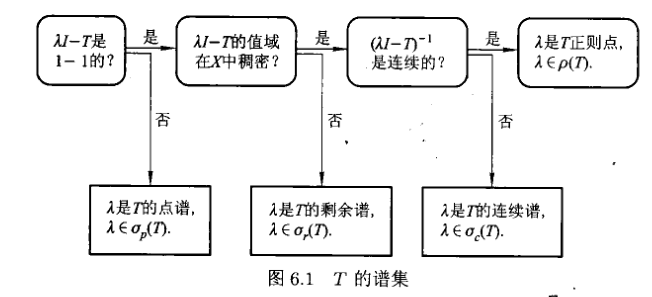

# 谱理论

- **符号约定**：
  - $D(A)$ 表示 $A$ 的定义域
  - 空间默认是复 $B$ 空间，所有线性算子默认为变换，$\t$ 是原点
  - $I$ 表示恒等映射
- **思想**：
  - 谱理论实际上就是高代里的特征值理论，但它比特征值复杂且广泛
  - 特征值的动机和意义很明确：将线性变换

## 无穷维空间的特征值理论

- **特征值和特征向量**：
  - 设 $\ms X$ 是复 $B$ 空间，$A: \Big( D(A) \subset \ms X \Big)\to\ms X$ 是线性算子
    - 必须将空间映射到自己（变换）
  - 若存在非零向量 $x_0$ 和 $\l\in\C$ 使得 $Ax_0 = \l x_0$
    - 特征向量不能为零向量（否则特征值不唯一）
  - 则 $\l$ 称为 $A$ 的一个特征值，$x_0$ 称为 $A$ 的一个特征向量
    - 特征值和特征向量一一对应
- **预解变换**：$\l I-A$
- **预解方程**：$(\l I - A) x = \t$
  - 预解的意思是：必须先用它判别原问题是否存在解
  - 比如一元二次方程的预解式是 $b^2-4ac$，如果它无根则原方程也无解
- **特征值判别定理**：$\l$ 是 $A$ 的特征值 $\LR$ 对应的预解方程存在非零解
- **特征向量判别定理**：$x$ 是 $A$ 关于 $\l$ 的特征向量 $\LR$ $x$ 在预解方程解空间 $\ker (\l I-A)$ 中
  - （特征向量集合）就是（预解方程的解集）

### 特征子空间

- **特征子空间**：$\ker (\l I-A)$ 称为 $A$ 关于特征值 $\l$ 的特征子空间
- **几何重数**：$\dim\ker(\l I-A)$ 称为特征值 $\l$ 的几何重数
- **直和性**：特征子空间彼此构成直和
  - **证明**：
    - 只需证明不同的特征值对应的特征向量线性无关即可
    - 反设线性相关，将 $A$ 作用在线性表出式两端，容易发现矛盾
- **特征向量的局域性**：$A$ 的特征向量必须位于 $D(A)$ 中
  - **反例**：
    - 设 $\ms X = L^2(\R)$，$A$ 是卷积算子 $u\mapsto \dis\int^t_{-\infty} e^{-(t-\tau)}u(\tau)d\tau$
    - 易得 $D(A) = \ms X$
    - 取 $u(t) = e^{iwt}$，则计算易得 $Au(t) = \cfrac{1}{1+iw}e^{iwt} = \cfrac{1}{1+iw}u(t)$
    - 但因为 $u\notin L^2(\R)$，故 $\cfrac{1}{1+iw}$ 不是特征值（实际上它是连续谱）
- **特征子空间正交定理**：Hilbert空间上的自伴算子，其特征子空间相互正交
  - **证明**：和高代相同

## 算子的谱集

### 预解集和谱集

- **预解集**：$\rho(A) = \hkh{\l\in\C\Bigm| (\l I-A)^{-1}连续，\Im(\l I-A)稠密}$，其中的元素称为 $A$ 的**正则值**
  - 正则值不可能是特征值（若可逆，则核平凡，从而无根）
  - 要求稠密的原因：实际上一般讨论的都是闭线性算子的谱集。由前面闭图像定理的推论，逆映射连续的闭图像算子，其值域为闭集。再由像集稠密性即得 $\Im (\l I-A) = \ms X$，即 $\l I-A$ 是满射，从而 $\l I-A\in\ms L(\ms X)$
- **谱集**：$\sigma(A) = \C \j \rho(A)$
  - 非正则值也不一定就是特征值

### 谱集的分类

- **有穷维分类定理**：有穷维空间中，$\l\in\C$ 要么是正则值，要么是特征值
  - **证明**：
    - 已知有穷维空间中，线性算子必定连续，且值域为整个空间
    - 此时若 $\l I-A$ 可逆，则 $\l$ 为正则值。若不可逆，则 $\l$ 为特征值
- **无穷维分类定理**：
  - 若 $(\l I-A)^{-1}$ 不存在，则 $\l$ 是特征值
    - 不可逆等价于 $\ker (\l I-A)$ 存在非零元素，即存在特征向量
    - **点谱 $\sigma_p(A)$**：全体特征值的集合
  - 若 $(\l I-A)^{-1}$ 存在
    - （此时 $\l$ 不一定是正则值，因为 $(\l I-A)^{-1}$ 不一定连续）
    - **预解集**：若 $(\l I-A)^{-1}$ 连续，且 $\Im (\l I-A)$ 稠密，则 $\l$ 是正则值
      - 当 $A$ 是闭线性算子时，只需 $\Im(\l I-A) = \ms X$ 即可
      - 预解变换对应的PDE是适定的
    - **连续谱 $\sigma_c(A)$**：若 $\Im(\l I-A)$ 稠密，但逆不连续，则称 $\l$ 位于连续谱中
      <!-- - $\begin{cases} \Im (\l I-A)\neq \ms X \\\\ \ol{\Im (\l I-A)}= \ms X \end{cases}$ -->
      - 预解变换的像集稠密，且非满射
      - 此时伴随算子无特征值
    - **剩余谱 $\sigma_r(A)$**：若 $\ol{\Im (\l I-A)}\neq \ms X$，则称 $\l$ 位于剩余谱中
      - 预解变换的像集稀疏
- **谱公式**：$\sigma(A) = \sigma_p(A) \cup \sigma_c(A) \cup \sigma_r(A)$
  - **证明**：
    - 由定义易得结论
- **谱的判断过程**：
 
 
- 两边的性质在两种意义下分别都是最好的，而中间的性质是最差的
- 点谱说明预解变换可以特征分解
- 正则值说明预解方程存在唯一的稳定解
- 剩余谱是性质最差的

## 闭线性算子的谱集

- **全空间定理**：若 $A$ 是闭线性算子，则 $\l\in\rho(A)\LR \l I-A$ 是双射
  - 由闭图像定理，若闭算子是双射，则逆连续
  - **证明（充分性）**：闭图像定理直得
  - **证明（必要性）**：
    - 由正则值的定义，只需证明 $D(\l I-A)^{-1} = \ms X$ 即可
    - 任取 $y\in\ms X$，由正则值定义，$\Im (\l I-A)$ 是稠密集，故存在点列满足 $\lim\limits_{n\to\infty} (\l I-A)x_n = y$
      - 易得 $\exists m>0$ 使得 $\forall x\in D(A)，\|(\l I-A)x\| \geq m\|x\|$
      - 故 $x_n$ 是柯西列，再由 $\ms X$ 完备性，存在极限 $x_n\to x$
      - 再由 $A$ 是闭算子，即得 $x\in D(A)，y\in\Im (\l I-A)$
      - 最后由任意性即得结论
- **分类定理**：
  - **点谱**：$(\l I-A)^{-1}$ 不存在
    - 预解方程存在解
  - **预解集**：$(\l I-A)^{-1}$ 存在，且 $\Im(\l I-A) = \ms X$
    - 预解变换是双射（核不平凡，且是满射）
  - **连续谱 $\sigma_c(A)$**：$(\l I-A)^{-1}$ 存在，且 $\Im (\l I-A)\neq \ms X$ 稠密
    - 预解变换是单射，且像集稠密
  - **剩余谱 $\sigma_r(A)$**：$(\l I-A)^{-1}$ 存在，且 $\ol{\Im (\l I-A)}\neq \ms X$
    - 预解变换是单射，且像集稀疏

## 伴随算子的谱集

- 注意：必须是有界线性算子才具有伴随

### 巴纳赫空间

- **Banach伴随谱定理**：设 $T\in\ms L(\ms X)$，则 $\sigma(T) = \sigma(T^*)$
  - 注意这里是非内积空间。内积空间需要取共轭
  - **证明**：
    - 只需证明 $T^{-1}\in\opx \LR (T^*)^{-1}\in\ms L (\ms X^*)$ 即可
      - 由 $T$ 的任意性即得对 $\l I-T$ 也成立，从而谱集相同
    - **必要性**：由 $(T^*)^{-1} = (T^{-1})^*$ 直得结论
    - **充分性**：
      - 由必要性结论得此时 $(T^{**})^{-1} \in \ms L(\ms X^{**})$
        - 再由自然映射嵌入性即得 $T$ 是闭值域嵌入
      - 反设存在 $x_0\in\ms X\j\Im T$，则由H-B定理，存在单点延拓 $f$ 满足 $$\begin{cases} f(x_0) = \|x_0\| \\ f(x) = 0 & \forall x\in\Im T \end{cases}$$
        - 因为 $x_0\notin \Im T$，由闭集性易得该方向上的向量也不在 $\Im T$ 中。再由于单点延拓在其它方向的取值可以任意小，这么取确实是合理的
        - 此时 $\forall y\in\ms X，0 = \lang f,Ty \rang = \lang T^*f,y \rang$，由向量判零定理，只能是 $T^*f = 0$，即 $f\in \ker T^*$
        - 再由充分性条件，$T^*$ 可逆，从而只能是 $f = \t$，矛盾
  - **理解**：
    - 首先我们把问题简化为零特征情况，这是非常重要的一步
    - 再由必要性结论转化为第二对偶空间，即只需证明 $T$ 是满射
    - 再由H-B定理得
  - **本质**：其实只需要把预解方程取伴随即可
- **预解方程伴随定理**：若 $T\in \opx$，则 $\ol{\Im(\l I -T)} = \ms X \LR \ker(\l-T^*) = 0$
  - 设 $\l$ 是谱点，则此时
    - $\l$ 是连续谱点 $\LR \l$ 不是 $T^*$ 的特征值
    - $\l$ 是剩余谱点 $\LR \l$ 是 $T^*$ 的特征值
  - **证明**：由像核对偶引理直得结论
  <!-- - 从正则点逼近连续谱点时，PDE的解存在唯一，但不稳定（适定性在趋近时退化） -->

### 希尔伯特空间

- **Hilbert共轭谱定理**：若 $T\in\ms L(H)$，则 $\sigma(T^*) = \hkh{\ol \l\Bigm| \l\in\sigma(T)}$
  - （伴随算子的谱）是（原算子谱的共轭）
  - **证明**：
    - 由于 $I^* = I$，故易得 $(\ol \l I-T^*)^{-1} = \Big[ (\l I-T)^{-1} \Big]^*$，再由定义即得结论
    - 希尔伯特空间必定自反，故证明比巴纳赫空间简单很多
  - **几何意义**：彼此对偶的算子，其谱集关于实轴对称
- **预解方程伴随定理**：若 $T\in \opx$，则 $\ol{\Im(\l I -T)} = \ms X \LR \ker(\ol\l-T^*) = 0$
  - 即有以下对偶关系
    - $\l$ 是 $T$ 的点谱 $\LR \ol\l$ 是 $T^*$ 的剩余谱
    - $\l$ 是 $T$ 的剩余谱 $\LR \ol\l$ 是 $T^*$ 的点谱
  - 还有以下推论：
    - 若 $\l$ 是谱点，则 $\l$ 是 $T$ 的连续谱 $\LR \ol\l$ 不是 $T^*$ 的特征值

## 习题

- **闭算子正则值求法**：
  - 设 $A$ 是闭线性算子
  - 若 $\forall f\in\ms X$，$(\l I-A)u = f$ 都存在唯一解
  - 则 $\l$ 是正则值
  - **证明**：
    - 由存在唯一解可得 $(\l I-A)$ 存在左右逆，即可逆
    - 再由 $f$ 任意性可得 $\Im(\l I-A) = \ms X$
    - 再由闭算子的逆传递性易得 $(\l I-A)^{-1}$ 是闭线性算子，且定义域是全空间
    - 再由闭图像定理即得 $(\l I-A)^{-1}$ 连续
- **谱集的多项式传递性**：设 $p$ 是 $\C$ 上多项式，则 $\sigma\Big( p(T) \Big) = p\Big( \sigma(T) \Big)$
  - 正则值也同理
  - **证明**：定义易得
- **谱集的逆公式**：设 $T\in\ms L(\ms X)$，则 $\sigma(T^{-1}) = \hkh{\l\in\C \Bigm| \dfrac{1}{\l}\in\sigma(T) }$
  - **证明**：
    - 显然 $(\l I-T)$ 可逆 $\LR (T-\dfrac{1}{\l} I)$ 可逆

## 实例（定义法求谱集）

### 有界线性算子

- **有限维线性变换**：有限维空间中，线性算子只有点谱
- **连续函数空间 + 乘变量算子**：
  - 设 $\ms X = C[0,1]$，$A$ 是乘变量算子 $u(t)\mapsto t\cdot u(t)$
  - 则
    - $A$ 是有界线性算子
    - 谱集为剩余谱 $\sigma(A) = \sigma_r(A) = [0,1]$
  - **证明（有界线性）**：易得
  - **证明（谱）**
    - 若 $\l\notin [0,1]$
      - **正则值**：
        - 显然此时预解逆变换 $(\l-t)^{-1}$ 存在且连续，从而是正则值
        - 再由任意性即得 $\R\j [0,1]\subset \rho(A)$，即 $\sigma(A)\subset [0,1]$
    - 若 $\l\in [0,1]$
      - **非点谱**：
        - 此时预解方程 $(\l-t)u(t) = 0$ 的解只可能是 $u\equiv 0$，故预解变换可逆
        - 即 $\l$ 不是特征值
      - **非正则**：
        - 易得预解逆变换 $(\l-t)^{-1}$ 无界
          - $t=\l$ 时 $(\l-t)^{-1}u(t) = \infty$，故一致范数始终为无穷
        - 即 $\l$ 不是正则值
      - **剩余谱**：
        - **值域闭性**：
          - 易得 $\Im(\l-t) = \hkh{f\in C[0,1]\Bigm| f(\l) = 0}$
          - 设 $f_n\to f$，此时 $|f(\l)| = |f(\l) - f_n(\l)| \leq \|f-f_n\|_{\infty}\to 0$
          - 即值域是闭的
        - **恒等映射反例**：
          - 考虑 $(\l-t)u = \id$
            - 易得解为 $u(t) = (\l-t)^{-1}$，易得该解不连续，即 $u\notin \ms X$，从而 $\id\notin\Im(\l I-A)$
            - 再由值域是闭集即得 $\id\notin \ol{\Im(\l I-A)}$
            - 但显然 $\id\in\ms X$，故像集不稠密
        - 即 $\l$ 为剩余谱点，再由任意性即得结论
- **二阶可积空间 + 乘变量算子**：
  - 设 $\ms X = L^2[0,1]$，$A$ 是乘变量算子 $u(t)\mapsto t\cdot u(t)$
  - 则
    - $A$ 是有界线性算子
    - 谱集为连续谱 $\sigma(A) = \sigma_c(A) = [0,1]$
  - **证明（有界线性）**：易得
  - **证明（谱）**
    - 若 $\l\notin[0,1]$
      - **正则值**：同上
    - 若 $\l\in [0,1]$
      - **非点谱**：同上
      - **非正则**：
        - 易得预解逆变换 $(\l-t)^{-1}$ 无界
          - 若取 $u(t) = (\l-t)^{\dfrac{1}{4}}$，则 $\dis\int^{\l+\d}_{\l-\d} |(\l-t)^{-1}u|^2 dt = \dis\int^{\d}_{-\d} t^{-\dfrac{3}{2}}dt$，显然它反常不可积，故预解逆变换存在无界点
          - 这里要注意 $u(t) = \sqrt{\l-t}$ 是二阶不可积的，不能拿它当例子
      - **连续谱**：
        - **值域非闭性**：显然 $f_n = \chi_{[0，\l-\frac{1}{n}]}$ 是柯西列，但极限不满足 $f(\l) = 0$
        - **值域稠密性**：
          - 易得 $\Im(\l I-A) = \hkh{f\in L^2[0,1]\Bigm| \dfrac{f(t)}{\l-t}\in L^2[0,1]}$
          - 要证明它的稠密性，只需证明 $\dfrac{f(t)}{\l-t}$ 不二阶可积时，能被可积的逼近
          - 显然不可积的情况只能是 $\l$ 的邻域内不可积，故我们用挖去（$\l$ 的不断减小的邻域）的方式，即可逼近它
        - **恒等映射情况**：
          - 考虑 $(\l-t)u = \id$
            - 易得它的解 $u(t) = (\l-t)^{-1}$ 二阶不可积，即 $u\notin\ms X$
            - 但我们用 $f_n = \chi_{[0，1-\frac{1}{n}]}$ 即可逼近它

### 闭线性算子

- **二阶可积空间 + 负二阶微分算子**：
  - 设 $\ms X = L^2[0,1]$，$A$ 是负的二阶微分算子 $-\dfrac{d^2}{dt^2}$
  - 则
    - 取合适的定义域时，$A$ 是闭线性算子
    - 谱集为点谱 $\sigma(A) = \sigma_p(A) = \hkh{(2n\pi)^2\mid n\in\natnums}$
    - 当改变定义域时，谱会改变
  - **证明（闭化）**：
    - 虽然可积不一定可微，但我们可用傅里叶级数的一致收敛性来间接定义微分
    - 已知 $L^2$ 满足傅里叶级数一致收敛性
    - 先将 $u\in\ms X$ 傅立叶展开，再映射即得 $(Au)(t) = \sum\limits^\infty_{n=-\infty} (2n\pi)^2 u_ne^{2\pi int}$
    - 设定义域 $D(A) = \hkh{u\in\ms X\mid Au\in\ms X}$，则易得 $D(A)$ 在图模下完备，故 $A$ 是闭线性算子
      <!-- - 易得它就是狄利克雷边界下的索伯列夫空间 $H^2_0(\O)$
      - 首先证明图模和 $H^2$ 范数等价，故拓扑向量同构，即 $D(A)$ 在图模下完备 $\LR D(A)$ 是 $H^2$ 的闭子空间
      - 再为了保证 $A$ 的自伴性，必须要求边界项为零，故取狄利克雷边值 -->
  - **证明（谱集）**：
    - **预解方程**：$(\l I-A)x = \t$ 转化为 $$ (2n\pi)^2 u + u'' = 0 $$
    - **求解**：
      - 高阶常系数ODE的特征法即可
      - 显然三角基 $\{\sin(n\pi)t，\cos(n\pi)t\}$ 都是上式的根，故 $(2n\pi)^2\in \sigma_p(A)$
    - **排除其它情况**：
      - 反设 $\l\neq (2n\pi)^2$
      - 由ODE知识得 $\forall f\in L^2[0,1]，(\l I - A)u(t) = f(t)$ 有唯一解 $$\begin{cases} u(t) = \dis\sum^\infty_{i=-\infty} \cfrac{f_n}{(2n\pi)^2 - \l}e^{2\pi int} \\\\ f_n = \dis\int^1_0 f(t)e^{-2\pi int}dt \end{cases}$$
        - 显然 $f_n$ 就是 $f$ 的傅里叶系数
      - 再由分母有界性，可设 $M_\l = \sup\limits_{n\in\mb Z}\cfrac{1}{(2n\pi)^2 - \l^2}$
        - 由最值放缩 + Parseval恒等式得 $$\|u\|^2 \leq M_\l^2\sum\limits^\infty_{n=-\infty} |f_n|^2 = M_\l\|f\|^2$$
        - 即 $u\in L^2$ 存在，再由算子闭性，结合习题结论即得 $\l\in\rho(A)$

